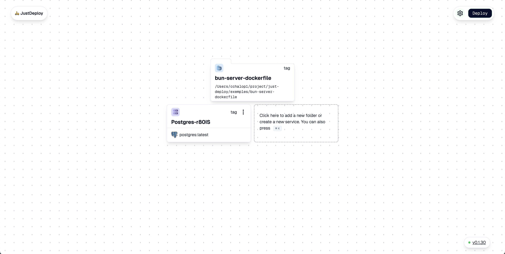
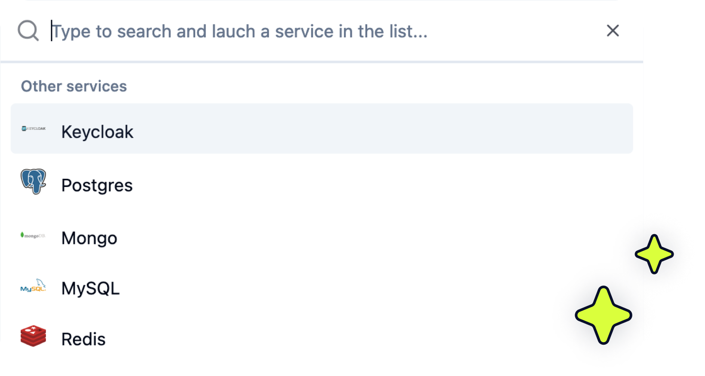

<h1 align="center">JustDeploy 🛵</h1>
<p align="center">Deploy what you want where you want !</p>

<p align="center">
  <a href="https://www.producthunt.com/posts/justdeploy-2?embed=true&utm_source=badge-featured&utm_medium=badge&utm_souce=badge-justdeploy&#0045;2" target="_blank">
    
  </a>
</p>



<br>

JustDeploy is a PaaS tool designed to simplify the lives of developers. Install it on your server to easily deploy your projects and databases. It's based on Docker, so JustDeploy fetches your GitHub repository and deploys your application using your Docker and Docker Compose configurations. All while deploying to any VPS of your choice. Forget about vendor lock-in—deploy wherever you want.

<br>

## Features

- 🚀 **Deploy full-stack apps in one click**
- ⚙️ **Manage environments seamlessly**
- 🗂️ **Project Management**
- 🌐 **Deploy on any VPS**
- 🔓 **No vendor lock-in—deploy wherever you want**
- 🐙 **Github integration push to deploy**

<br>

## 

## Prerequisites

Before getting started, your server need to be debian base or have docker.

---

## Security upgrade and access

Read [SECURITY-UPGRADE.md](SECURITY-UPGRADE.md) before installation or upgrade. Administration requires HTTPS for remote access. Create the first administrator account from the web interface. The runtime data directory must be mounted persistently. Go 1.26.10 and Bun 1.3.10 are used for builds; Docker Engine 25 or newer is required.

## Installation

To install JustDeploy on your server, run the following command:

Your server needs to be running Debian.

```bash
curl -fsSL https://get.justdeploy.app | bash
```

If you prefer, you can also run JustDeploy in Docker. With the following command, you will pull and run JustDeploy.

```bash
docker run -d --name justdeploy \
  -p 127.0.0.1:5915:5915 \
  -v /var/lib/justdeploy:/app/data \
  -v /var/run/docker.sock:/var/run/docker.sock \
  --restart=unless-stopped \
  cchalop1/justdeploy
```

---

## Usage

After installation, the installer waits for the API to respond and prints your next steps:

1. On your computer, open an SSH tunnel using the command printed by the installer. Typically: `ssh -N -L 5915:127.0.0.1:5915 root@YOUR_VPS_IP`.
2. Keep that terminal open and visit `http://localhost:5915`.
3. Create your administrator account with your email and password. No domain is required.
4. Choose **Create a database** for a private service, or **Deploy my application** to connect GitHub and select a repository.
5. Review the service's environment variables and port, then click **Save and deploy**. Pending dependencies in its connection group are deployed first; unrelated groups are left alone.

Private databases do not require GitHub or a domain. They are reachable by service name from applications in the same connection group; their credentials remain in the service settings.

For GitHub integration, first configure public HTTPS access to the administration interface using the [HTTPS instructions](SECURITY-UPGRADE.md#administration-and-first-setup), then reopen JustDeploy at that address. The tunnel alone does not make GitHub callbacks or webhooks publicly reachable.

To expose an application, configure the server domain in Global settings, point the application hostname (or a wildcard) to the VPS, allow inbound ports 80 and 443, and enable HTTPS for deployed services. This application routing is separate from the administration interface's HTTPS configuration. After deployment, use **Open my application** to check the public URL. Container startup checks do not verify public DNS or HTTP reachability.

---

## Why Choose JustDeploy?

- **Full Control**: Deploy where you want without extra costs or limitations.
- **Developer-Friendly**: Intuitive and designed to simplify everyday tasks for developers.

---

## Join the Community

- ⭐ Star the repository on [GitHub](https://github.com/cchalop1/JustDeploy)
- 📖 Follow [discussions](https://github.com/cchalop1/JustDeploy/discussions)
- 🐛 Report issues [here](https://github.com/cchalop1/JustDeploy/issues)
- 💬 Follow me on [Twitter](https://x.com/ChalopinClement)
- 🎮 Join our [Discord](https://discord.gg/RteyWyKjz4)

---

## License

This project is licensed under the AGPL-3.0 License. See the [LICENSE](https://github.com/cchalop1/JustDeploy/blob/main/LICENSE) file for more details.
